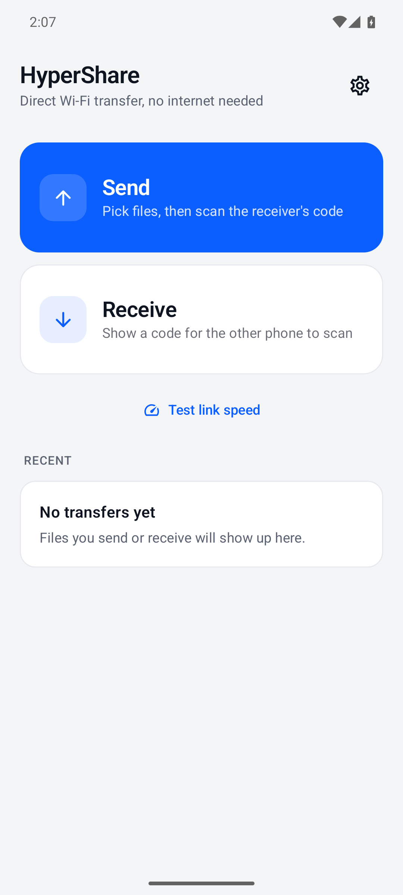
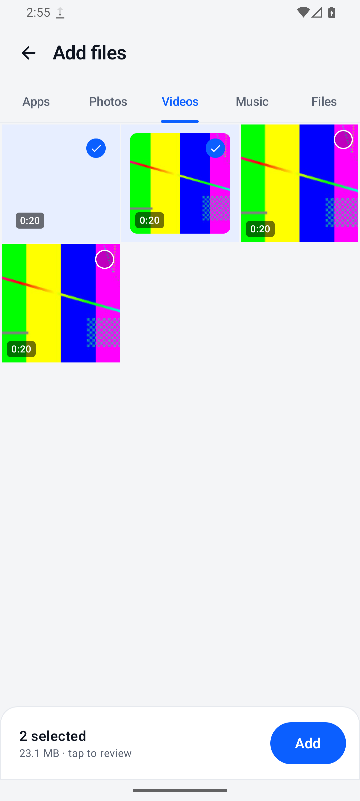
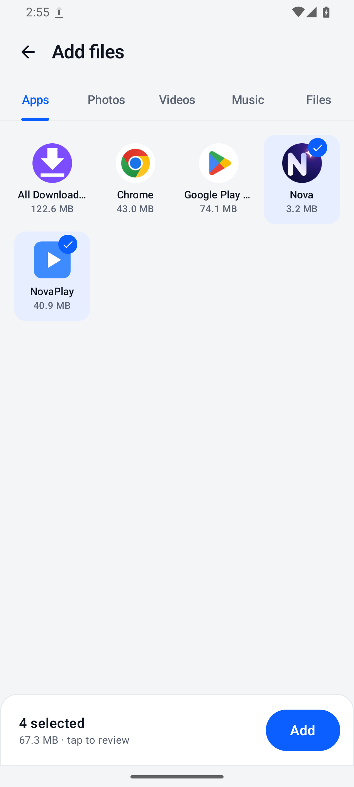
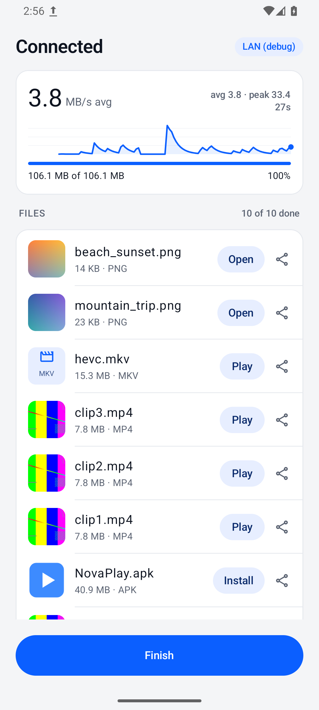
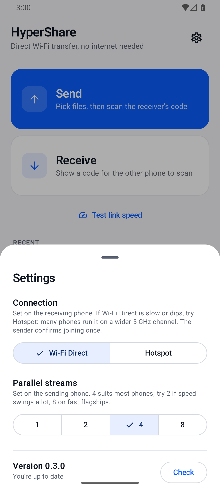

# HyperShare

Fast phone-to-phone file transfer for Android over **Wi-Fi Direct**. No internet, no router, no account needed.

The receiving phone shows a QR code, the sending phone scans it, and the files go straight over a direct 5 GHz Wi-Fi link.

<p>
  
  
  
  
  
</p>

> Screenshots are from the Android emulator. The transfer screen was captured during an emulator-to-emulator test over a debug-only network link, so its chip reads "LAN (debug)"; real phones show "Wi-Fi Direct" or "Hotspot".

## Download

Get the APK from [Releases](../../releases/latest). You need Android 8 or newer, with Wi-Fi turned on. On Android 8–9 the sending phone briefly leaves its normal Wi-Fi network while it joins the receiver; it reconnects afterwards.

After that, the app updates itself: it checks GitHub Releases on launch and shows an **Update** banner when a new version is out.

> Coming from v0.1.0? Uninstall it once first. From v0.2.0 on, releases are signed with a permanent key, so in-app updates install over the top.

## How to use

1. **Phone A** (receiver): tap **Receive**. A QR code appears.
2. **Phone B** (sender): tap **Send**, choose from the Apps, Photos, Videos, Music or Files tabs, tap **Send**, then scan the code.
3. Files are saved on Phone A in `Downloads/HyperShare`.

**Test link speed** sends 2 GB of dummy data without reading or writing storage. Use it to see your phones' raw link speed.

## Expected speed

| Link | Typical speed |
|---|---|
| 2.4 GHz | 5–15 MB/s |
| 5 GHz, Wi-Fi 5, 40 MHz channel | 25–40 MB/s |
| 5 GHz, Wi-Fi 5/6, 80 MHz channel, 2x2 antennas | 50–90 MB/s |

The app shows the link frequency it got, along with live and average MB/s.

## Features

- **Built-in picker:** tabs for Apps, Photos, Videos, Music and Files.
  - **Apps:** sends the APK, including split APKs.
  - **Files:** use the system picker, or send a whole folder; the receiver keeps its sub-folders.
- **One open session:** after the first batch, the sender can tap **Send more** without pairing again. **Finish** ends the session on both phones.
- **Per-file control:** either phone can cancel a single file while it's waiting or in progress.
- **Actions by file type** when a file arrives:
  - **Install** for APKs, including split APKs.
  - **Play** for video and audio.
  - **Open** for everything else.
  - **Share** for any file.
- **Live stats:** a compact speed card with a chart, average, peak and time remaining.
- **Two connection types** (Settings, chosen on the receiver):
  - **Wi-Fi Direct** (default).
  - **Hotspot:** a local-only hotspot. Many phones run it on a wider 5 GHz channel, so it can be faster on the same pair of phones. The sender confirms joining once.
- **In-app updates** from GitHub Releases, **dark mode**, and a **Recent** list.

## How it's fast

- **No discovery step:** the QR code carries the Wi-Fi Direct group name and password, so the sender joins directly instead of scanning for peers.
- **One channel only:** if the receiver is already on a 5 GHz Wi-Fi network, the Wi-Fi Direct group is created on that same channel. Otherwise the phone's single radio would keep hopping between two channels, which halves the speed and makes it jumpy. If that channel isn't available, it falls back to any 5 GHz channel, then to automatic.
- **Warns about channel hopping:** if either phone is on a Wi-Fi network on a different channel, the app says so and explains how to fix it.
- **4 parallel TCP streams:** files are split into 4 MB chunks, and each stream pulls the next free chunk.
- **Kernel-tuned TCP:** socket buffer sizes are left to Linux's automatic TCP tuning (setting them by hand switches it off, which caused v0.1's speed swings). Data goes through direct `ByteBuffer`s. Each chunk's header and data go out in one gathering write, and the receiver writes chunks straight to their position in the file, in parallel.
- **Integrity check:** every chunk carries a CRC32 checksum, which uses the CPU's hardware CRC instruction on ARM so it costs almost nothing.
- **No TLS:** the Wi-Fi Direct link is already WPA2-encrypted, so there's no second encryption layer slowing it down.
- **Radio stays awake:** a foreground service holds a `WIFI_MODE_FULL_LOW_LATENCY` Wi-Fi lock and a wake lock during transfers, so Wi-Fi power saving doesn't throttle them.

## Testing without two phones

Debug builds can run a transfer between two emulators over adb port forwarding, skipping the Wi-Fi Direct and hotspot step:

```bash
emulator -avd <avd> -read-only -port 5560 &  emulator -avd <avd> -read-only -port 5562 &
adb -s emulator-5560 shell am start -n com.hypershare/.ui.MainActivity --ez debug_receive_lan true
adb -s emulator-5560 forward tcp:8988 tcp:8988 && adb -s emulator-5560 forward tcp:8989 tcp:8989
adb -s emulator-5562 shell am start -n com.hypershare/.ui.MainActivity --es debug_send_qr "'HSX3|L|-|-|0|0|10.0.2.2'"
```

## Build and release

```bash
./gradlew assembleRelease            # app/build/outputs/apk/release/app-release.apk
./release.sh 0.2.1 "What changed"    # bump version, build, tag, push, publish GitHub release
```

The release signing key is read from `~/.hypershare/keystore.properties`, outside the repo. Back it up: if it's lost, users can't update in place anymore.

Requires JDK 17 and Android SDK 36.

## Code map

| File | What it does |
|---|---|
| `p2p/P2p.kt` | Wi-Fi Direct group and local-only hotspot (host and join); the QR invite |
| `data/Media.kt` | Lists apps, photos, videos and music; expands folders |
| `transfer/Engine.kt` | Session protocol (add/skip/finish over a control socket, 4 data streams), progress, state |
| `transfer/Io.kt` | Chunk protocol, socket tuning, file reading and writing (MediaStore) |
| `service/TransferService.kt` | Foreground service, Wi-Fi lock and wake lock |
| `update/Updater.kt`, `Installer.kt` | Self-update from GitHub Releases; installs received APKs (incl. splits) |
| `data/History.kt` | Recent transfers list and settings |
| `ui/*.kt` | Compose screens: Home, Send review, Receive, Transfer; theme and components |

## Limitations

- One session at a time, one direction only (the receiver can't send back in the same session).
- No resume: an interrupted transfer starts over.
