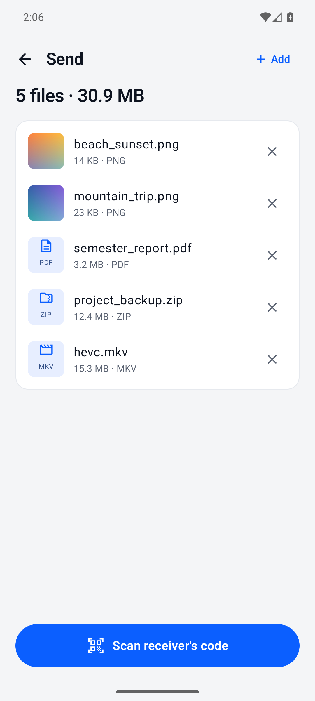

# HyperShare

Fast phone-to-phone file transfer for Android over **Wi-Fi Direct**. No internet, no router, no account needed.

The receiving phone shows a QR code, the sending phone scans it, and the files go straight over a direct 5 GHz Wi-Fi link.

<p>
  
  
  
  
</p>

> Screenshots are from the Android emulator. The emulator only has 2.4 GHz, so the Receive screen shows its slow-band warning. Real phones use 5 GHz.

## Download

Get the APK from [Releases](../../releases/latest). You need Android 10 or newer, with Wi-Fi turned on.

After that, the app updates itself: it checks GitHub Releases on launch and shows an **Update** banner when a new version is out.

> Coming from v0.1.0? Uninstall it once first. From v0.2.0 on, releases are signed with a permanent key, so in-app updates install over the top.

## How to use

1. **Phone A** (receiver): tap **Receive**. A QR code appears.
2. **Phone B** (sender): tap **Send**, pick the files, then tap **Scan receiver's code**.
3. Files are saved on Phone A in `Downloads/HyperShare`.

**Test link speed** sends 2 GB of dummy data without reading or writing storage. Use it to see your phones' raw link speed.

## Expected speed

| Link | Typical speed |
|---|---|
| 2.4 GHz | 5–15 MB/s |
| 5 GHz, Wi-Fi 5, 40 MHz channel | 25–40 MB/s |
| 5 GHz, Wi-Fi 5/6, 80 MHz channel, 2x2 antennas | 50–90 MB/s |

The app shows the link frequency it got, along with live and average MB/s.

## Features

- **Send screen:** check the files before sending, with thumbnails, sizes and file types. Remove or add files before pairing.
- **Transfer screen:** live speed with a scrolling chart, average, peak and time remaining. Each file shows its own progress, then **Open** and **Share** buttons when it's done.
- **Recent:** a history of sent and received files; tap one to open it.
- **Settings:** number of parallel streams (1/2/4/8) and a manual update check.
- **Dark mode**, and haptic feedback when a transfer finishes.

## How it's fast

- **No discovery step:** the QR code carries the Wi-Fi Direct group name and password, so the sender joins directly instead of scanning for peers.
- **One channel only:** if the receiver is already on a 5 GHz Wi-Fi network, the Wi-Fi Direct group is created on that same channel. Otherwise the phone's single radio would keep hopping between two channels, which halves the speed and makes it jumpy. If that channel isn't available, it falls back to any 5 GHz channel, then to automatic.
- **Warns about channel hopping:** if either phone is on a Wi-Fi network on a different channel, the app says so and explains how to fix it.
- **4 parallel TCP streams:** files are split into 4 MB chunks, and each stream pulls the next free chunk.
- **Kernel-tuned TCP:** socket buffer sizes are left to Linux's automatic TCP tuning (setting them by hand switches it off, which caused v0.1's speed swings). Data goes through direct `ByteBuffer`s. Each chunk's header and data go out in one gathering write, and the receiver writes chunks straight to their position in the file, in parallel.
- **Integrity check:** every chunk carries a CRC32 checksum, which uses the CPU's hardware CRC instruction on ARM so it costs almost nothing.
- **No TLS:** the Wi-Fi Direct link is already WPA2-encrypted, so there's no second encryption layer slowing it down.
- **Radio stays awake:** a foreground service holds a `WIFI_MODE_FULL_LOW_LATENCY` Wi-Fi lock and a wake lock during transfers, so Wi-Fi power saving doesn't throttle them.

## Build and release

```bash
./gradlew assembleRelease            # app/build/outputs/apk/release/app-release.apk
./release.sh 0.2.1 "What changed"    # bump version, build, tag, push, publish GitHub release
```

The release signing key is read from `~/.hypershare/keystore.properties`, outside the repo. Back it up: if it's lost, users can't update in place anymore.

Requires JDK 17 and Android SDK 36.

## Code map

| File | What it does |
|---|---|
| `p2p/P2p.kt` | Creates and joins the Wi-Fi Direct group; makes the QR invite |
| `transfer/Engine.kt` | Sender and receiver logic, progress, state |
| `transfer/Io.kt` | Chunk protocol, socket tuning, file reading and writing (MediaStore) |
| `service/TransferService.kt` | Foreground service, Wi-Fi lock and wake lock |
| `update/Updater.kt` | Checks GitHub Releases, downloads the APK, installs it with PackageInstaller |
| `data/History.kt` | Recent transfers list and settings |
| `ui/*.kt` | Compose screens: Home, Send review, Receive, Transfer; theme and components |

## Limitations

- One transfer at a time, one direction only.
- No resume: an interrupted transfer starts over.
