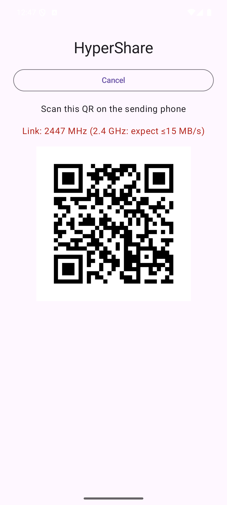

# HyperShare

Fast phone-to-phone file transfer for Android over **Wi-Fi Direct**. No internet, no router, no account needed.

The receiving phone shows a QR code, the sending phone scans it, and the files go straight over a direct 5 GHz Wi-Fi link.

<p>
  
  &nbsp;&nbsp;
  
</p>

> The receive screenshot was taken on the Android emulator. The emulator only has 2.4 GHz, so the app shows its slow-link warning. Real phones use 5 GHz.

## Download

Get the APK from [Releases](../../releases/latest). You need Android 10 or newer, with Wi-Fi turned on.

## How to use

1. **Phone A** (receiver): tap **Receive**. A QR code appears.
2. **Phone B** (sender): tap **Send files**, pick the files, then scan the QR code.
3. Files are saved on Phone A in `Downloads/HyperShare`.

**Speed test** sends 2 GB of dummy data without reading or writing storage. Use it to see your phones' raw link speed.

## Expected speed

| Link | Typical speed |
|---|---|
| 2.4 GHz | 5–15 MB/s |
| 5 GHz, Wi-Fi 5, 40 MHz channel | 25–40 MB/s |
| 5 GHz, Wi-Fi 5/6, 80 MHz channel, 2x2 antennas | 50–90 MB/s |

The app shows the link frequency it got, along with live and average MB/s.

## How it's fast

- **No discovery step:** the QR code carries the Wi-Fi Direct group name and password, so the sender joins directly instead of scanning for peers.
- **5 GHz first:** the group is created with `GROUP_OWNER_BAND_5GHZ`, and falls back to automatic only if the phone refuses 5 GHz.
- **4 parallel TCP streams:** files are split into 4 MB chunks, and each stream pulls the next free chunk.
- **Big socket buffers:** 4 MB socket buffers and direct `ByteBuffer`s. Each chunk's header and data go out in one gathering write, and the receiver writes chunks straight to their position in the file, in parallel.
- **Integrity check:** every chunk carries a CRC32 checksum, which uses the CPU's hardware CRC instruction on ARM so it costs almost nothing.
- **No TLS:** the Wi-Fi Direct link is already WPA2-encrypted, so there's no second encryption layer slowing it down.
- **Radio stays awake:** a foreground service holds a `WIFI_MODE_FULL_LOW_LATENCY` Wi-Fi lock and a wake lock during transfers, so Wi-Fi power saving doesn't throttle them.

## Build

```bash
./gradlew assembleRelease
# app/build/outputs/apk/release/app-release.apk
```

Requires JDK 17 and Android SDK 36.

## Code map

| File | What it does |
|---|---|
| `p2p/P2p.kt` | Creates and joins the Wi-Fi Direct group; makes the QR invite |
| `transfer/Engine.kt` | Sender and receiver logic, progress, state |
| `transfer/Io.kt` | Chunk protocol, socket tuning, file reading and writing (MediaStore) |
| `service/TransferService.kt` | Foreground service, Wi-Fi lock and wake lock |
| `ui/MainActivity.kt` | Compose UI, QR scanning and display |

## Limitations

- One transfer at a time, one direction only.
- No resume: an interrupted transfer starts over.
- Release builds are signed with a debug key, so they're not suitable for the Play Store as-is.
